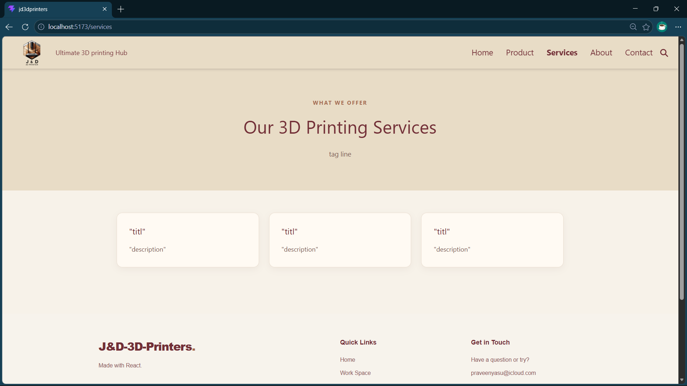
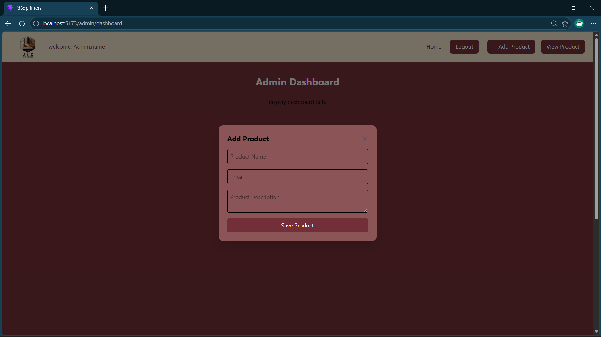

to do list:-

  -------->
add About section details,
add Services details
  ----->
add img support,     
add edit button in: http://localhost:5173/admin/dashboard --> viewProduct,
add dynamic admin user.name in admin navbaar,
add dashboad elements: : http://localhost:5173/admin/dashboard,
add google analytics: https://analytics.google.com/analytics/web/,
add db details: : http://localhost:5173/admin/dashboard, 

PAGES:-

Page	Route	Purpose
Login	/login	Sign in
Register	/register	Create an account
Forgot Password	/forgot-password	Reset password
Categories	/categories	Manage transaction categories
Accounts	/accounts	Manage cash and bank accounts
Notifications	/notifications	Show alerts and reminders
Help / Support	/help	FAQs and assistance
404 Not Found

components:-
-----
list it here
--------

Folder Structure 
update folder structure here if anychanges are made:-
-----
src/
├── assets/
│   ├── images/
│   └── icons/
│
├── components/
│   ├── common/
│   │   ├── Button.jsx
│   │   ├── Input.jsx
│   │   ├── Card.jsx
│   │   ├── Modal.jsx
│   │  
│   │  
│   │
│   ├── layout/
│   │   ├── Navbar.jsx
│   │   ├── Sidebar.jsx
│   │   ├── Header.jsx
│   │   └── MainLayout.jsx
│   │
│   ├── dashboard/
│   │   ├── QuickView.jsx
│   │   ├── StatCard.jsx
│   │   ├── IncomeExpenseChart.jsx
│   │   └── RecentTransactions.jsx
│   │
├── pages/
│   ├── Dashboard.jsx
│   ├── Transactions.jsx
│   ├── Reports.jsx
│   ├── Categories.jsx
│   ├── Accounts.jsx
│   ├── Settings.jsx
│   ├── Login.jsx
│   ├── Register.jsx
│   └── NotFound.jsx
│
├── hooks/
│   └── useTransactions.js
│
├── context/
│   └── TransactionContext.jsx
│
├── services/
│   ├── api.js
│   └── transactionService.js
│
├── utils/
│   ├── formatCurrency.js
│   └── calculateTotals.js
│
├── App.jsx
├── main.jsx
└── index.css
------------